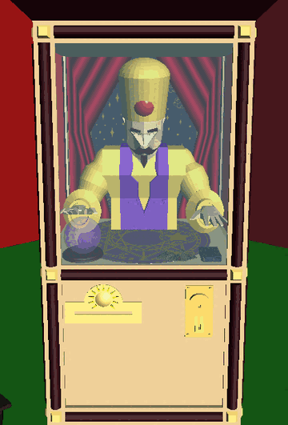
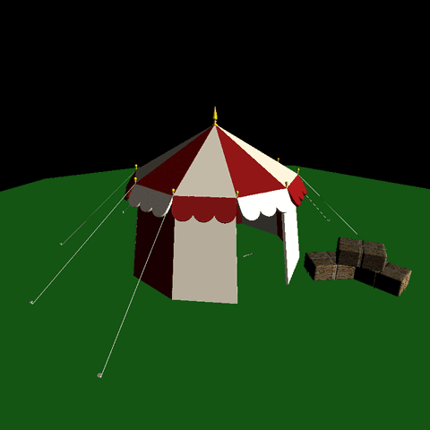

# IG · Informática Gráfica

Práctica final de la asignatura Informática Gráfica del Grado en Ingeniería Informática de la Universidad de Granada, hecha en C con OpenGL y GLUT.

## La escena

Es una carpa de feria con fardos de paja y un tiovivo con caballos que suben y bajan, y dentro hay una máquina del adivino al estilo de Zoltar. La máquina es una vitrina con cortinas y un adivino con turbante sentado delante de una bola de cristal, cartas del tarot, monedas y un cofre. Todo está montado con modelos PLY, texturas JPG e iluminación, y la cámara se mueve alrededor de la escena.

Al principio la idea era hacerlo todo con figuras básicas de OpenGL, como cubos, cilindros y prismas, y así están hechas la carpa y la máquina. Pero la cara y el cuerpo del adivino eran casi imposibles de hacer solo con esas formas, así que aprendí lo básico de Blender para modelarlo, y después también la moneda, el fardo de heno y el ticket de la fortuna. El tiovivo es un modelo descargado de internet, al que le puse texturas y una animación.

Lo más interesante es que la máquina funciona como una de verdad. Primero tienes que coger una moneda y meterla por la ranura. La moneda cae, el adivino se despierta, abre los ojos y empieza a mover la cabeza, la boca y el brazo sobre la bola de cristal. Cuando termina, se vuelve a dormir y suelta una carta de la fortuna por la ranura de la izquierda, que puedes recoger haciendo clic en ella. El cofre también se abre y se cierra al pulsarlo. Para saber qué objeto se ha pulsado, la escena se vuelve a dibujar con cada objeto pintado de un color que lo identifica y se lee el color del píxel que hay debajo del ratón, así que cada moneda, la ranura, la carta y el cofre tienen el suyo. Con los objetos con textura esto fallaba (a veces, al ir a recoger el ticket, se gastaba una moneda), así que esos objetos van metidos dentro de cubos invisibles, y el clic se detecta sobre esos cubos.

| El adivino en acción | Vuelta de 360° al adivino |
|---|---|
|  |  |

Por fuera, la carpa:



Las imágenes están sacadas del propio programa compilado en Linux, y las animaciones van algo más rápidas que en tiempo real.

## Cómo ejecutarlo

**Requisitos:** Linux (o WSL en Windows) con un compilador de C/C++ y las librerías de GLUT y JPEG.

1. Instala las dependencias (Ubuntu/Debian):
   ```bash
   sudo apt install build-essential freeglut3-dev libjpeg-dev
   ```
2. Compila y ejecuta:
   ```bash
   cd P-FINAL
   rm -f *.o practicasIG   # el repo trae ficheros compilados, así que mejor empezar de cero
   make
   ./practicasIG
   ```

La cámara empieza dentro de la carpa, delante de la máquina. Si quieres verla desde fuera, aléjate con `-` o AvPág.

## Controles

- **Clic izquierdo:** coger una moneda, meterla en la ranura, recoger la carta, abrir el cofre
- **Botón central del ratón:** girar la cámara
- **Botón derecho del ratón:** acercar y alejar la cámara
- **Flechas:** girar la cámara
- **+ / -, RePág / AvPág:** acercar y alejar
- **P / L / F:** dibujar en puntos, líneas o relleno
- **I:** activar o desactivar la iluminación
- **M:** activar o parar la animación del adivino a mano
- **H:** ayuda en la terminal
- **Esc:** salir

## Documentación

- **[DOCUMENTACIÓN.pdf](P-FINAL/DOCUMENTACI%C3%93N.pdf)** · La memoria de la práctica. Explica los controles y cómo funcionan las dos interacciones, la del cofre y la del adivino. Después cuenta paso a paso cómo se desarrolló: cómo pasé de las figuras básicas de OpenGL a modelar en Blender, por qué hubo que cambiar el lector de PLY para que leyera las coordenadas de textura (UV), el error al leer los vértices que cerraba el programa y cómo se arregló, y el truco de los cubos invisibles para la selección. Incluye también el grafo de escena y los tutoriales de Blender que seguí.

## Estructura

```
P-FINAL/
├── practicasIG.c      <- programa principal
├── modelo.c           <- la escena, la máquina y toda la animación
├── visual.c           <- cámara y proyección
├── entradaTeclado.c   <- teclado
├── mouse.c            <- ratón y selección de objetos
├── file_ply_stl.cc    <- lector de modelos PLY
├── lector-jpg.cpp     <- lector de texturas
├── *.ply / *.jpg      <- modelos y texturas
└── DOCUMENTACIÓN.pdf  <- memoria de la práctica
```

## Créditos

Programación, modelado en Blender y diseño de la escena: Fernando Lanzarot Facio. El modelo del tiovivo es de terceros.
