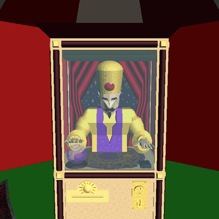

# IG · Informática Gráfica

Práctica final de **Informática Gráfica** (Grado en Ingeniería Informática, Universidad de Granada), escrita en **C con OpenGL y GLUT**.

La escena es una **carpa de feria** con fardos de paja alrededor. Dentro hay una **máquina del adivino tipo Zoltar**: una vitrina con cortinas, un adivino articulado con turbante, cartas del tarot, una bola de cristal, monedas y un cofre. Usa modelos PLY, texturas JPG, iluminación, cámara orbital y una animación del adivino.

## La escena

| El adivino en acción | Vuelta de 360° al adivino |
|---|---|
|  |  |

**Vista frontal:** se coge una moneda y se mete en la ranura de la derecha. La moneda cae, el adivino abre los ojos, mueve la cabeza, la boca y el brazo sobre la bola de cristal, vuelve a dormirse y entrega una carta de la fortuna por la ranura de la izquierda.

**Exterior:** la carpa de feria donde está la máquina.


Imágenes renderizadas con el propio programa, compilado en Linux. Las animaciones van más rápidas que en tiempo real.

## Contenido

Todo está en `P-FINAL/`:

- **Código**: `practicasIG.c` (programa principal), `modelo.c` (la escena y la animación), `visual.c` (cámara y proyección), `entradaTeclado.c` y `mouse.c` (controles), `file_ply_stl.cc` y `lector-jpg.cpp` (carga de modelos y texturas).
- **Modelos** `.ply` y **texturas** `.jpg`.
- **Memoria**: `DOCUMENTACIÓN.pdf`.

## Cómo ejecutarlo

Necesita Linux (o WSL en Windows) con un compilador de C/C++ y las librerías de GLUT y JPEG.

1. Instala las dependencias (Ubuntu/Debian):
   ```bash
   sudo apt install build-essential freeglut3-dev libjpeg-dev
   ```
2. Compila y ejecuta:
   ```bash
   cd P-FINAL
   rm -f *.o practicasIG   # quita los ficheros compilados que hay en el repo
   make
   ./practicasIG
   ```

La cámara empieza dentro de la carpa, delante de la máquina. Para ver la carpa desde fuera, aléjate con `-` o AvPág.

**Para que el adivino diga la fortuna:** haz clic en una de las monedas para cogerla y después haz clic en la ranura de monedas de la máquina. Cuando termine, haz clic en la carta para recogerla.

### Controles

| Tecla | Acción |
|---|---|
| Flechas | Girar la cámara |
| `+` / `-`, RePág / AvPág | Acercar / alejar |
| `p` / `l` / `f` | Dibujar en puntos / líneas / relleno |
| `i` | Activar o desactivar la iluminación |
| `m` | Iniciar o parar la animación |
| `h` | Ayuda en la terminal |
| `Esc` | Salir |

## Autoría

**Fernando Lanzarot Facio**.
